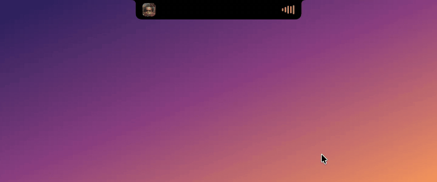
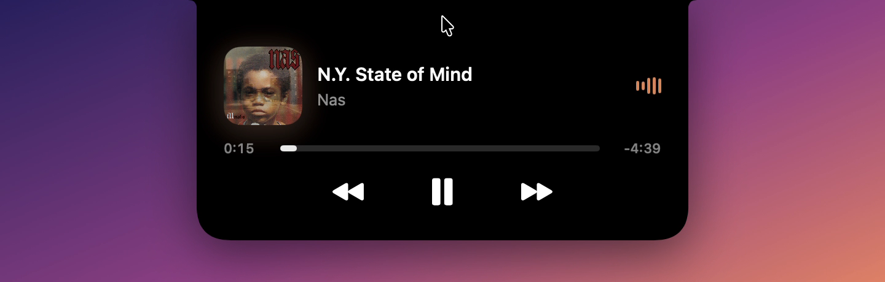
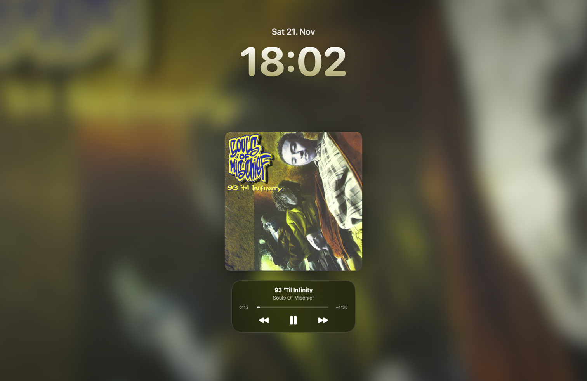

<div align="center">

# Islet

**A Dynamic Island for the MacBook notch.**

Music, volume and charging live in the notch, and the lock screen turns into your album cover.



</div>

## Why

The notch on my MacBook does nothing all day. On the iPhone that same black blob shows what's playing and reacts when something happens, and I wanted exactly that on the Mac without another subscription. So I wrote my own.

Islet is small (about 1,300 lines of Swift), has no dependencies and lives in the menu bar.

## What it does

<table>
<tr>
<td width="50%"></td>
<td width="50%"></td>
</tr>
<tr>
<td align="center"><sub>Cover and live bars while music plays</sub></td>
<td align="center"><sub>Volume changes show up in the notch</sub></td>
</tr>
</table>



- **Now playing**
- **Hover to expand**
- **Volume and charging**
- **Lock screen**
- **Menu bar toggles**

### Lock screen



Start typing or click the background and it steps aside so you can get to the password field.

## Install

1. Grab `Islet-1.0.zip` from the [latest release](../../releases/latest) and unzip it.
2. Move `Islet.app` to Applications.
3. The app is not notarized, so the first launch needs a right click → **Open**. If macOS still refuses:

```bash
xattr -cr /Applications/Islet.app
```

On first launch macOS asks whether Islet may control Spotify / Music. That is how it reads the current track, so say yes.

## Build it yourself

You need Xcode 16 or newer.

```bash
git clone https://github.com/milanundso/Islet.git
cd Islet
open Islet.xcodeproj
```

Hit Run. To get a zipped release build instead:

```bash
./scripts/package.sh
```

The zip ends up in `dist/`.

## How it's put together

```
Islet/
├── Island/       notch window, shape, compact and expanded views
├── Music/        Spotify / Apple Music via AppleScript
├── System/       volume (CoreAudio) and power (IOKit) monitors
└── LockScreen/   fullscreen artwork view and its window
```

No packages, no helper tools, just AppKit and SwiftUI.
